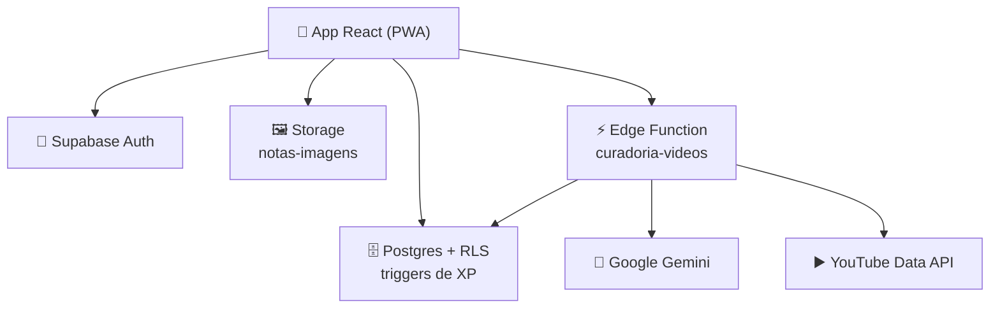

<div align="center">


# Trivium

**Estude, evolua de nível e deixe a IA encontrar a aula certa para você.**

Plataforma de estudos gamificada para alunos e professores,<br/>
com curadoria de videoaulas por IA. Instalável como app (PWA).

<br/>

[](https://react.dev)
[](https://vitejs.dev)
[](https://tailwindcss.com)
[](https://supabase.com)
[](https://ai.google.dev)
[](https://developers.google.com/youtube/v3)
[](https://web.dev/progressive-web-apps/)

<br/>

[**🚀 Abrir o app**](https://gabvasconceloss.github.io/Trivium/) ·
[Sobre](#-sobre-o-projeto) ·
[Funcionalidades](#-funcionalidades) ·
[Arquitetura](#-arquitetura) ·
[Rodar localmente](#-como-executar-localmente)

</div>

---

## 🎓 Sobre o projeto

O **Trivium** junta três coisas que costumam viver em apps separados: o **caderno** do aluno, as **atividades** do professor e um **sistema de progressão** estilo jogo.

Na prática, cada coisa que o aluno faz rende algo:

- 📝 **Cria um tópico** no caderno → a **IA sugere videoaulas** sobre o assunto.
- ▶️ **Assiste a uma aula** → conta como participação e mantém a **sequência de dias**.
- 📬 **Entrega uma atividade no prazo** → ganha **+20 XP**.
- 🏆 **Bate uma meta** → desbloqueia **conquistas**, **XP bônus** e **itens de perfil**.

Toda a pontuação é calculada **dentro do banco de dados**, por funções e triggers. O aluno não consegue alterar o próprio XP, nível ou nota pelo navegador.

> [!NOTE]
> Existem dois papéis com áreas separadas: **Aluno** (`/dashboard`, `/cadernos`, …) e **Professor** (`/professor/...`). Cada rota é protegida pelo papel do usuário logado.

---

## ✨ Funcionalidades

### 👨‍🏫 Professor

- **Turmas:** cria turmas e recebe um **código de acesso** para compartilhar com os alunos.
- **Atividades:** cria atividades com prazo por turma. Uma entrega pendente é gerada **automaticamente** para cada aluno.
- **Notas:** acompanha as entregas e lança a nota. Só o professor da turma consegue alterá-la.

### 👩‍🎓 Aluno

- **Dashboard:** XP, nível, sequência de dias 🔥 e média geral.
- **Cadernos:** matérias → tópicos, com **editor por blocos** (texto, subtítulo, lista, checklist, imagem e cartão) e salvamento automático.
- **Atividades:** marca como entregue e acompanha a nota.
- **Calendário:** eventos pessoais de estudo (não geram XP nem nota).
- **Conta:** preferências, incluindo **modo escuro**.

### 🤖 Curadoria de videoaulas com IA

1. O aluno pede aulas sobre um tópico do caderno.
2. A Edge Function `curadoria-videos` pede ao **Gemini** de 1 a 3 termos de busca adequados à idade do aluno. A IA **não** responde a matéria, só gera os termos.
3. Os termos vão para a **YouTube Data API** com busca segura, categoria *Educação*, idioma pt-BR e vídeos de duração média.
4. Os 3 vídeos ficam salvos no tópico e em um **cache** compartilhado. Uma busca repetida pelo mesmo assunto não gasta cota das APIs.
5. Os vídeos tocam dentro do app via `youtube-nocookie.com`.

> [!TIP]
> A função escolhe sozinha um modelo Gemini que esteja funcionando. Ela tenta os aliases `gemini-flash-latest` e `gemini-pro-latest` e, se falharem, procura na lista de modelos. Erros 429/503 são repetidos com espera.

### 🎮 Gamificação

- **XP em ledger:** todo ganho vira uma linha em `xp_transacoes`. Um trigger soma o XP e recalcula o nível.
- **Curva de nível:** do nível *N* para o *N+1* são `100 + 50 × (N − 1)` XP.
- **Ranking da turma:** geral (XP total) e semanal (últimos 7 dias).
- **Indicação de amigo:** cada aluno tem um código. Resgatar o código rende **+30 XP**.

<details>
<summary><b>🏆 Conquistas disponíveis</b></summary>

<br/>

- 🏆 **Pontual:** 3 entregas no prazo · +50 XP
- 📖 **Estudioso:** 3 resumos concluídos · +60 XP
- 👥 **Participativo:** 5 aulas assistidas · +100 XP
- 🗂️ **Mestre da Organização:** 20 entregas no prazo · +150 XP
- 🥇 **Nota de Ouro:** média acima de 9,0 · +200 XP
- 📅 **Frequência Perfeita:** 30 dias de sequência · +200 XP

</details>

<details>
<summary><b>🎨 Customização de perfil</b></summary>

<br/>

O aluno equipa **avatar**, **moldura**, **capa** e **título**. Os itens são liberados automaticamente ao subir de nível ou ao ganhar uma conquista específica. Alguns exemplos:

- **Molduras:** Básica (nv. 1) · Neon (nv. 2) · Fogo (nv. 4) · Cyberpunk (nv. 6)
- **Capas:** Synthwave (nv. 1) · Arcade (nv. 3) · Neo Tóquio e Galáxia (nv. 5)
- **Títulos:** de *Novato do Saber* (nv. 1) a *Lenda da Turma* (nv. 10), além de *Pontual* e *Estudioso*, que são liberados por conquista.

Itens bloqueados mostram o nível necessário. O banco recusa equipar um item que o aluno ainda não tem.

</details>

### 📱 PWA

O app pode ser instalado no celular e no desktop, tem service worker e funciona com cache. Os dados do Supabase usam a estratégia *NetworkFirst*: buscam na rede primeiro e, se ela falhar, usam o cache.

---

## 🧱 Arquitetura



**Front-end**

- React 18 + React Router 6 + Tailwind CSS 3
- Build com Vite 5 e `vite-plugin-pwa`
- Publicado no GitHub Pages em `/Trivium/`

**Back-end (Supabase)**

- **Auth:** login por e-mail e senha
- **Postgres:** 15 tabelas com **Row Level Security** em todas
- **Regras de negócio:** funções `SECURITY DEFINER` e triggers (XP, nível, conquistas, cosméticos, entregas)
- **Storage:** bucket `notas-imagens` para as imagens do editor
- **Edge Function (Deno):** `curadoria-videos`

> [!IMPORTANT]
> As chaves do Gemini e do YouTube ficam **somente** nas secrets da Edge Function. O front-end usa apenas a URL e a chave pública (*anon*) do Supabase.

---

## 🗂️ Estrutura do projeto

<details>
<summary><b>Ver árvore de diretórios</b></summary>

<br/>

```text
trivium/
├─ public/
│  ├─ icons/          # ícones do PWA
│  └─ robots.txt
├─ src/
│  ├─ components/     # UI reutilizável
│  │  ├─ BlockEditor.jsx
│  │  ├─ VideoPlayer.jsx
│  │  ├─ RotaProtegida.jsx
│  │  └─ ...
│  ├─ context/
│  │  └─ AuthContext.jsx
│  ├─ hooks/          # acesso a dados
│  │  ├─ useCadernos.js
│  │  ├─ useRanking.js
│  │  └─ ...
│  ├─ lib/
│  │  ├─ supabaseClient.js
│  │  ├─ curadoria.js
│  │  └─ erros.js     # mensagens em pt-BR
│  ├─ pages/          # telas do aluno
│  │  └─ professor/   # telas do professor
│  ├─ App.jsx         # rotas
│  └─ main.jsx
├─ supabase/
│  ├─ schema.sql      # tabelas, RLS, triggers
│  └─ functions/
│     └─ curadoria-videos/
│        └─ index.ts
├─ vite.config.js     # base + PWA
├─ tailwind.config.js
└─ package.json
```

</details>

<details>
<summary><b>Ver rotas do app</b></summary>

<br/>

**Públicas**

- `/login`
- `/criar-conta`

**Aluno**

- `/dashboard`
- `/cadernos`
- `/caderno/:materiaId`
- `/caderno/:materiaId/topico/:topicoId`
- `/atividades`
- `/calendario`
- `/conquistas`
- `/perfil`
- `/conta`

**Professor**

- `/professor/turmas`
- `/professor/turmas/:turmaId`
- `/professor/atividades/:atividadeId`
- `/professor/conta`

</details>

---

## 🚀 Como executar localmente

### Pré-requisitos

- **Node.js** 18 ou superior e **npm**
- Um projeto no **[Supabase](https://supabase.com)**
- Para a curadoria por IA: **Supabase CLI**, uma chave da **Gemini API** e uma da **YouTube Data API v3**

### 1. Instalar

```bash
git clone https://github.com/gabvasconceloss/Trivium.git
cd Trivium/trivium
npm install
```

### 2. Variáveis de ambiente

Copie o modelo e preencha com os dados de **Project Settings → API** no Supabase:

```bash
cp .env.example .env
```

```env
VITE_SUPABASE_URL=https://xxxx.supabase.co
VITE_SUPABASE_ANON_KEY=sua-chave-anon
```

> [!CAUTION]
> Nunca faça commit do `.env`. Ele já está no `.gitignore`.

### 3. Banco de dados

No **SQL Editor** do Supabase, cole e rode o arquivo `supabase/schema.sql` inteiro. Ele cria as tabelas, as policies de RLS, os triggers, o bucket de Storage e o catálogo inicial de conquistas e cosméticos.

> [!TIP]
> Para testar mais rápido, desative **Confirm email** em *Authentication → Settings*.

### 4. Edge Function (curadoria por IA)

```bash
supabase login
supabase link --project-ref SEU_REF
supabase functions deploy curadoria-videos
supabase secrets set GEMINI_API_KEY=...
supabase secrets set YOUTUBE_API_KEY=...
```

### 5. Rodar

```bash
npm run dev
```

O app abre em `http://localhost:5173/Trivium/`.

<details>
<summary><b>Todos os scripts</b></summary>

<br/>

- `npm run dev` / `npm start`: servidor de desenvolvimento
- `npm run build`: build de produção em `dist/`
- `npm run preview`: serve o build localmente

</details>

<details>
<summary><b>Roteiro rápido de teste</b></summary>

<br/>

1. Cadastre-se como **Professor**, crie uma turma e copie o código.
2. Em outra sessão, cadastre-se como **Aluno** usando esse código.
3. Como professor, crie uma atividade na turma.
4. Como aluno, marque a atividade como entregue, crie um caderno e um tópico e busque aulas com IA.
5. Como professor, lance a nota da atividade.
6. Como aluno, confira XP, nível, ranking e conquistas em **Meu Perfil**.

</details>

---

## 🤝 Contribuição

1. Crie uma branch a partir da `main`.
2. Faça commits pequenos e descritivos (ex.: `fix:`, `feat:`, `chore:`).
3. Abra um **Pull Request para a `main`**. Nada é enviado direto para a `main`.

> [!NOTE]
> O deploy no GitHub Pages é manual: faça o build da `main` e publique o conteúdo de `dist/` na branch `gh-pages`.

## 📄 Licença

Este projeto ainda não tem uma licença definida. Todos os direitos são reservados ao autor.

---

<div align="center">

Desenvolvido por **Gabriel Vasconcelos Franco Martins**<br/>
<sub>Engenharia de Software</sub>

</div>
