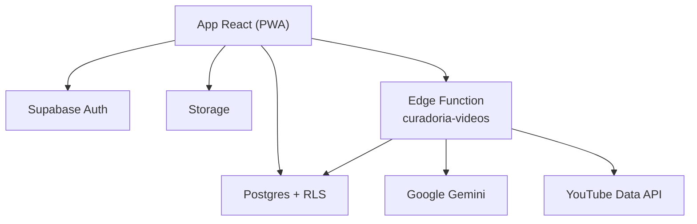

<div align="center">


<h1>Trivium</h1>

<p>
  Plataforma de estudos gamificada para alunos e professores,<br/>
  com curadoria de videoaulas por inteligência artificial.
</p>

<p>
  <a href="https://gabvasconceloss.github.io/Trivium/"><strong>Acessar aplicação</strong></a>
  ·
  <a href="#como-executar-localmente">Executar localmente</a>
  ·
  <a href="#arquitetura">Arquitetura</a>
</p>

[](https://react.dev)
[](https://vitejs.dev)
[](https://tailwindcss.com)
[](https://supabase.com)
[](https://ai.google.dev)
[](https://web.dev/progressive-web-apps/)

</div>

<br/>

## Visão geral

O Trivium reúne em um único ambiente o caderno do aluno, as atividades da turma e um sistema de progressão baseado em XP. Cada ação de estudo gera um resultado mensurável:

- **Criar um tópico** no caderno permite buscar videoaulas recomendadas por IA.
- **Assistir a uma aula** registra participação e mantém a sequência de dias de estudo.
- **Entregar uma atividade no prazo** concede 20 XP.
- **Atingir metas** libera conquistas, XP bônus e itens de personalização de perfil.

Toda a lógica de pontuação é executada no banco de dados, por meio de funções e triggers. O cliente não tem permissão para alterar XP, nível ou notas.

> [!NOTE]
> A aplicação possui dois papéis, **Aluno** e **Professor**, com áreas e rotas separadas. O acesso a cada rota é validado pelo papel do usuário autenticado.

## Funcionalidades

### Professor

- **Turmas:** criação de turmas com código de acesso gerado automaticamente.
- **Atividades:** cadastro de atividades com prazo. Uma entrega pendente é criada para cada aluno da turma.
- **Avaliação:** acompanhamento das entregas e lançamento de notas. Somente o professor da turma pode alterá-las.

### Aluno

- **Dashboard:** XP, nível, sequência de dias e média geral.
- **Cadernos:** organização por matéria e tópico, com editor em blocos (texto, subtítulo, lista, checklist, imagem e cartão) e salvamento automático.
- **Atividades:** registro de entrega e consulta de notas.
- **Calendário:** eventos pessoais de estudo, sem impacto em XP ou notas.
- **Conta:** preferências pessoais, incluindo modo escuro.

### Curadoria de videoaulas

A busca de aulas é feita pela Edge Function `curadoria-videos`:

1. O **Gemini** gera de 1 a 3 termos de busca adequados à idade do aluno. O modelo é instruído a não responder o conteúdo, apenas a gerar os termos.
2. A **YouTube Data API** busca os vídeos com filtro de conteúdo seguro, categoria Educação, idioma pt-BR e duração média.
3. Os três resultados são salvos no tópico e em um cache compartilhado, evitando novas chamadas às APIs para o mesmo assunto.
4. A reprodução acontece dentro da aplicação, via `youtube-nocookie.com`.

> [!TIP]
> A função resolve automaticamente um modelo Gemini disponível. Ela tenta primeiro os aliases `gemini-flash-latest` e `gemini-pro-latest` e, se falharem, consulta a lista de modelos. Respostas 429 e 503 são repetidas com intervalo progressivo.

### Gamificação

- **Ledger de XP:** cada ganho é registrado em `xp_transacoes`. Um trigger atualiza o total e recalcula o nível.
- **Progressão:** passar do nível *N* para o *N + 1* exige `100 + 50 × (N − 1)` XP.
- **Ranking:** classificação da turma geral (XP total) e semanal (últimos 7 dias).
- **Indicação:** cada aluno tem um código próprio. Resgatar o código de um colega concede 30 XP.

<details>
<summary><strong>Conquistas</strong></summary>

<br/>

- **Pontual:** 3 entregas no prazo (+50 XP)
- **Estudioso:** 3 resumos concluídos (+60 XP)
- **Participativo:** 5 aulas assistidas (+100 XP)
- **Mestre da Organização:** 20 entregas no prazo (+150 XP)
- **Nota de Ouro:** média acima de 9,0 (+200 XP)
- **Frequência Perfeita:** 30 dias de sequência (+200 XP)

</details>

<details>
<summary><strong>Personalização de perfil</strong></summary>

<br/>

O aluno pode equipar avatar, moldura, capa e título. Os itens são liberados por nível ou por conquista:

- **Molduras:** Básica (nível 1), Neon (2), Fogo (4) e Cyberpunk (6)
- **Capas:** Synthwave (1), Arcade (3), Neo Tóquio e Galáxia (5)
- **Títulos:** de *Novato do Saber* (1) a *Lenda da Turma* (10), além de *Pontual* e *Estudioso*, liberados por conquista

Itens bloqueados exibem o requisito de desbloqueio. O banco recusa equipar itens que o aluno ainda não possui.

</details>

### Aplicativo instalável

A aplicação é um PWA, com service worker e cache. Requisições de dados ao Supabase usam a estratégia *NetworkFirst*: buscam na rede primeiro e recorrem ao cache em caso de falha.

## Arquitetura



**Front-end**

- React 18, React Router 6 e Tailwind CSS 3
- Build com Vite 5 e `vite-plugin-pwa`
- Hospedagem no GitHub Pages, sob o caminho `/Trivium/`

**Back-end (Supabase)**

- **Auth:** autenticação por e-mail e senha
- **Postgres:** 15 tabelas, todas com Row Level Security
- **Regras de negócio:** funções `SECURITY DEFINER` e triggers para XP, nível, conquistas, cosméticos e entregas
- **Storage:** bucket `notas-imagens` para as imagens do editor
- **Edge Functions (Deno):** `curadoria-videos`

> [!IMPORTANT]
> As chaves do Gemini e do YouTube ficam exclusivamente nas secrets da Edge Function. O front-end utiliza apenas a URL do projeto e a chave pública (`anon`) do Supabase.

<details>
<summary><strong>Estrutura de diretórios</strong></summary>

<br/>

```text
trivium/
├─ public/
│  └─ icons/           Ícones do PWA
├─ src/
│  ├─ components/      Componentes de interface
│  ├─ context/         Autenticação e sessão
│  ├─ hooks/           Acesso a dados
│  ├─ lib/             Cliente Supabase e utilitários
│  ├─ pages/           Telas do aluno
│  │  └─ professor/    Telas do professor
│  ├─ App.jsx          Definição de rotas
│  └─ main.jsx
├─ supabase/
│  ├─ schema.sql       Tabelas, RLS e triggers
│  └─ functions/
│     └─ curadoria-videos/
├─ vite.config.js
├─ tailwind.config.js
└─ package.json
```

</details>

<details>
<summary><strong>Rotas</strong></summary>

<br/>

**Públicas:** `/login`, `/criar-conta`

**Aluno:**

- `/dashboard`
- `/cadernos`
- `/caderno/:materiaId`
- `/caderno/:materiaId/topico/:topicoId`
- `/atividades`
- `/calendario`
- `/conquistas`
- `/perfil`
- `/conta`

**Professor:**

- `/professor/turmas`
- `/professor/turmas/:turmaId`
- `/professor/atividades/:atividadeId`
- `/professor/conta`

</details>

## Como executar localmente

### Pré-requisitos

- Node.js 18 ou superior
- Um projeto no [Supabase](https://supabase.com)
- Para a curadoria: [Supabase CLI](https://supabase.com/docs/guides/cli), chave da Gemini API e chave da YouTube Data API v3

### 1. Instalação

```bash
git clone https://github.com/gabvasconceloss/Trivium.git
cd Trivium/trivium
npm install
```

### 2. Variáveis de ambiente

```bash
cp .env.example .env
```

Preencha com os valores de **Project Settings → API** no painel do Supabase:

```env
VITE_SUPABASE_URL=https://xxxx.supabase.co
VITE_SUPABASE_ANON_KEY=sua-chave-anon
```

### 3. Banco de dados

Execute o conteúdo de `supabase/schema.sql` no **SQL Editor** do Supabase. O script cria tabelas, policies, triggers, o bucket de Storage e o catálogo inicial de conquistas e cosméticos.

> [!TIP]
> Em ambiente de desenvolvimento, desative **Confirm email** em *Authentication → Settings* para agilizar os testes.

### 4. Edge Function

```bash
supabase login
supabase link --project-ref SEU_REF
supabase functions deploy curadoria-videos
supabase secrets set GEMINI_API_KEY=...
supabase secrets set YOUTUBE_API_KEY=...
```

### 5. Execução

```bash
npm run dev
```

A aplicação fica disponível em `http://localhost:5173/Trivium/`.

<details>
<summary><strong>Scripts disponíveis</strong></summary>

<br/>

- `npm run dev`: servidor de desenvolvimento (alias: `npm start`)
- `npm run build`: build de produção em `dist/`
- `npm run preview`: serve o build localmente

</details>

<details>
<summary><strong>Roteiro de validação</strong></summary>

<br/>

1. Crie uma conta de **Professor**, cadastre uma turma e copie o código de acesso.
2. Em outra sessão, crie uma conta de **Aluno** com esse código.
3. Como professor, crie uma atividade para a turma.
4. Como aluno, registre a entrega, crie um caderno e um tópico e busque videoaulas.
5. Como professor, lance a nota da atividade.
6. Como aluno, verifique XP, nível, ranking e conquistas no perfil.

</details>

## Contribuição

1. Crie uma branch a partir da `main`.
2. Use mensagens de commit no padrão [Conventional Commits](https://www.conventionalcommits.org/pt-br/) (`feat:`, `fix:`, `docs:`, `chore:`).
3. Abra um Pull Request para a `main`. Alterações não são enviadas diretamente para a `main`.

> [!NOTE]
> O deploy no GitHub Pages é manual: gere o build a partir da `main` e publique o conteúdo de `dist/` na branch `gh-pages`.

## Licença

Este projeto ainda não possui licença definida. Todos os direitos são reservados ao autor.

<br/>

<div align="center">
<sub>Desenvolvido por <strong>Gabriel Vasconcelos Franco Martins</strong> · Engenharia de Software</sub>
</div>
